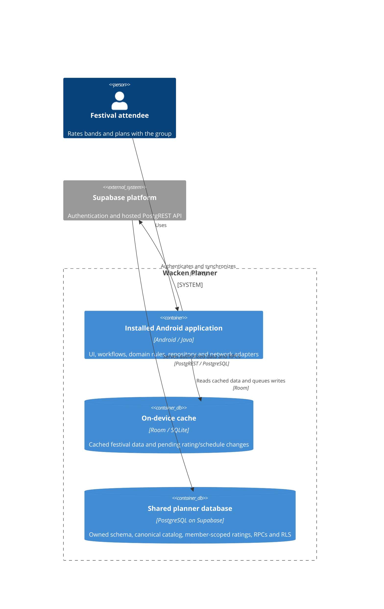
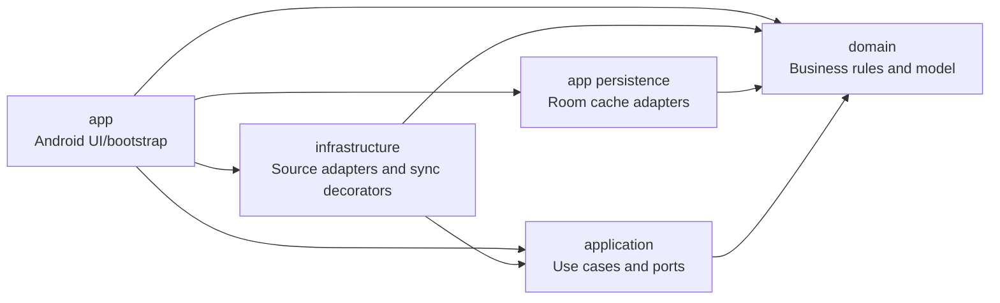
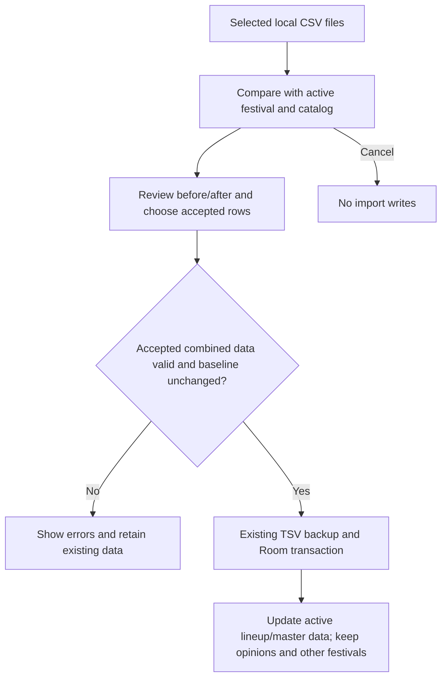
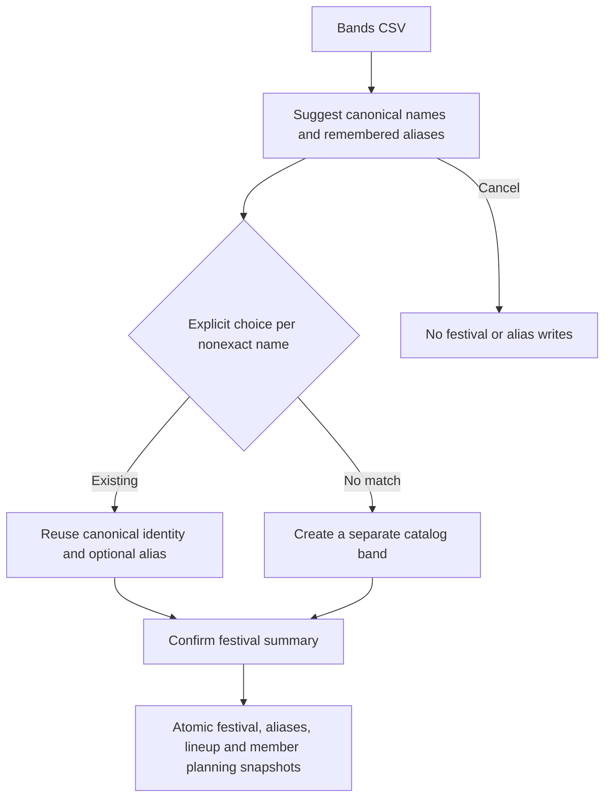
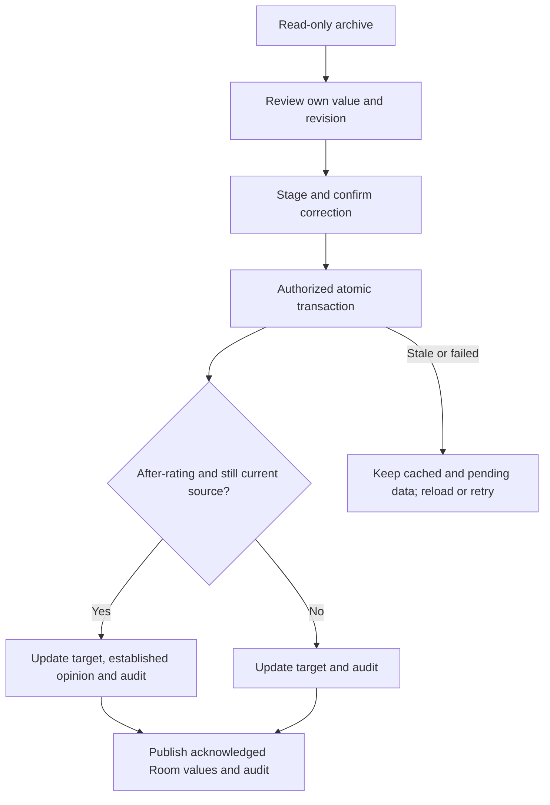
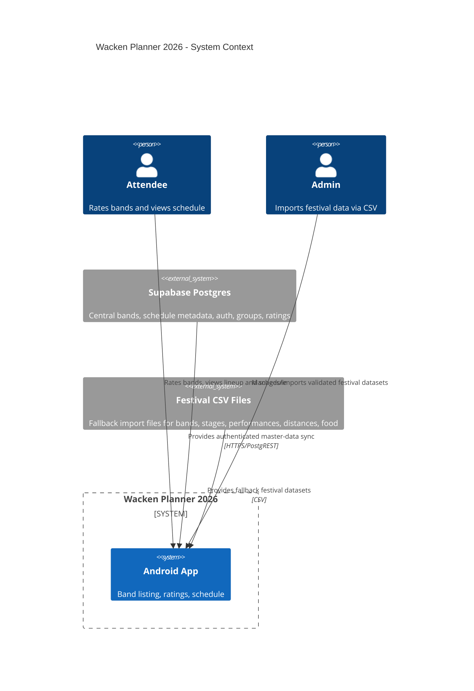
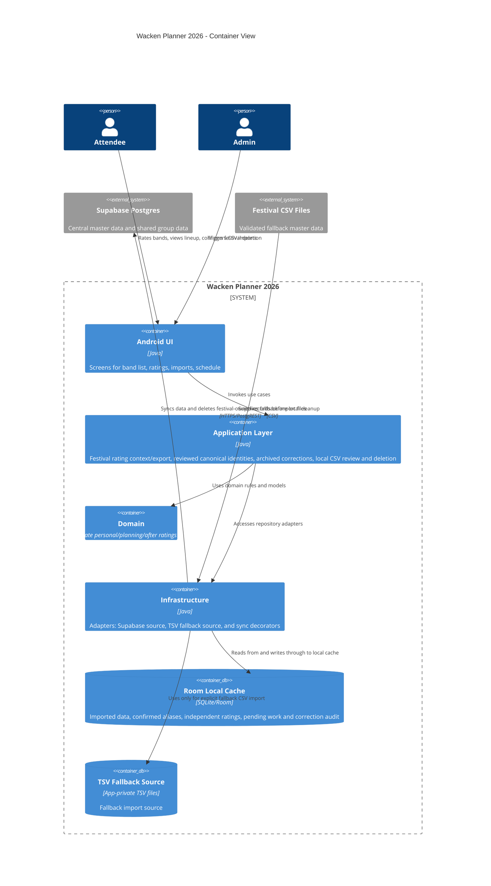

# Wacken Planner 2026

## Validated design for release 3.0

Validated direction: [paired Ironline dark / Field Notes light flow](design/release-2.34/themes.html), with a header toggle and System / Dark / Light preference in Settings. The user approved this flow; implementation is planned in the release 3.0 milestone (TASK-204–213), separately from 2.34.

Five interactive HTML design directions are available in the [design study](design/release-2.34/README.md): [open the prototype](design/release-2.34/index.html), [compare the styles](design/release-2.34/compare.html), and follow the [review exercise](design/release-2.34/review-guide.md). They use simulated data and do not change the released Android app. The [validation record](design/release-2.34/validation-review.md) distinguishes user approval from the native accessibility/device checks still needed for 3.0. Run `python3 -m http.server 8234 --bind 127.0.0.1 --directory design/release-2.34` and visit `http://127.0.0.1:8234/index.html` for a local browser preview.

## Context
- Android app for Wacken Open Air 2026 helping friends rate bands and build a shared, conflict-aware schedule.
- Respects shared ratings, veto rules, overlapping performances, walking-time context, and manual group choices when proposing timelines.

## Basic Functionality (MVP 1)

> Release 2.34 architecture: [ADR-0016](backlog/decisions/0016-band-catalog-and-archive-promoted-personal-ratings.md)
> defines one canonical band catalog, personal established band ratings and separate
> festival planning/after-ratings. Creation copies band ratings once; archive promotes
> nonempty after-ratings atomically. Missing values retain prior band ratings; older
> corrections cannot overwrite newer sources. TASK-216–220 and the aligned
> stories implement and validate this model, including reviewed aliases/local CSV,
> audited archived corrections, contextual detail and lifecycle export. Signed
> GitHub APK distribution remains the selected release channel; native paired
> appearance changes remain in3.0.

- Import festival data (bands, stages, performances, distances, food) from validated CSV files by selecting files in the Android import screen.
- Show locally cached lineup, planning ratings, real post-show ratings, schedule data, and manual schedule locks first, while Supabase sync refreshes Room in the background.
- List bands in a compact dark table with Band, Rating, Stage, Date, and Time columns.
- Hide generic Metal Battle placeholder acts from rating lists and rating allocation counts while preserving imported master data.
- Show compact read-only per-person star details on band detail and schedule decision detail screens when group ratings are available.
- Let users rate bands on a 1-5 scale (1 = veto, 5 = must-see), with 0 reserved for unrated bands/no filled stars, and clear a previous rating back to unrated.
- Let users record a separate real post-show rating on band detail after seeing a band, with its own 1-5 scale and reset-to-unrated behavior; real ratings are local/offline-first and do not affect group schedule decisions.
- Store every real post-show rating as personal band rating history with festival and created-date context, sync that history to Supabase, and show it on band detail and archived festival history screens.
- Delete an active or archived festival after confirmation, including its lineup, planning ratings, performances, and schedule decisions; preserve central bands and personal rating history.
- Export all locally cached band rating data from Settings as a CSV file for Android share/save targets, including planning ratings, real post-show ratings, cached group member ratings, and schedule metadata where known.
- Start on the active festival band list, with `Wacken Open Air 2026` seeded as the default active festival. **Archive** first syncs pending work, then commits archive status and each current member's final nonempty after-ratings to their established band ratings together. Planning ratings stay unchanged; missing/reset after-ratings retain established opinions. Only confirmed success moves to the archive list and add-festival entry point. Recovered legacy after-ratings must be reviewed on band detail before archive. Offline or conflicting work stays cached with an error and recovery guidance.
- Add the next festival from a band CSV after the active festival is archived; the festival name starts empty and must be filled in explicitly. Exact band-name matches reuse existing band records and new names create catalog records without invented metadata or links. The atomic creation transaction copies each current member's established band rating into their own planning rating once; missing opinions stay unrated and festival after-ratings start empty. Later edits and retries preserve the snapshot. The response contains only the creator's planning values, while shared planning sync supplies the existing group schedule view.
- Save rating and manual schedule-lock changes locally immediately, queue them as pending offline operations, and sync them with Supabase in the background on start/reactivation, on manual sync, or before close.
- Open known YouTube and Spotify links from overview rows and band detail screens. If no channel or artist link is stored, leave the action empty; importing a band does not invent a music link.
- Find missing music links from Settings → Admin → Find music links for the active festival, or Band Links → Find music links for one band. Review identity evidence and explicitly approve verified profiles; edited search terms never rename the band.
- Show readable imported English band biography/explanation and available band image metadata on the detail screen when source data provides it, without leaking raw HTML tags.
- Return from band detail to the same overview band row after refresh so users can continue rating without losing their place.
- Sign in with Supabase Auth so ratings can be associated with a user and the shared Wacken planning group.
- Keep the band overview focused with compact settings, schedule, and sync-exit icon actions; settings contains group invite, lineup import, active-festival rename, reviewed imported-band linking, reviewed metadata search/enrichment, rating export, and manual Supabase sync.
- Share plain-text invite instructions for the single shared `Sofie and Dino` planning group through Android's share sheet.
- Generate and view an MVP2 day-filtered calendar schedule with fixed stage labels on the left and horizontally scrollable time columns across the top, using shared ratings, middle-30-minute conflict rules, optional decisions, winner stars, and lost-alternative stars; the view can locally hide barred overlapping acts or acts at/below a selected star threshold; tapping a performance block opens the chosen act and alternatives, and alternatives can be selected as Supabase-synced locked group winners.

## Architecture

The versioned [Groma map](groma/project.md) preserves source ownership, stable
element IDs, groups, descriptions, authored relationships and scenario flows.
The [20 October audit](backlog/docs/groma-audit-2026-10-20.md) records its known
gaps: no container records, 72 disconnected records and 99 duplicate candidate
groups. TASK-226 preserves that baseline; TASK-227–233 repair and validate it.
Preservation does not establish architecture completeness.

Use the repository-pinned **Groma 0.7.2 container-curation patch**, with
**@groma/scanner-java@0.2.2** pinned in [`groma/config.json`](groma/config.json).
Automatic updates are disabled. Provide Bun **1.4.3** on PATH (or set BUN to its
absolute executable path), then build the tool from the exact upstream commit
and checked patch. This leaves global/npm installations unchanged:

```bash
sh scripts/setup-groma.sh
sh scripts/groma.sh --version
sh scripts/groma.sh scanner list
sh scripts/groma.sh view --plain
sh scripts/groma.sh scan
sh scripts/groma.sh lint --max-count 200
```

The launcher verifies the [tool pin](tools/groma/pin.json), patch checksum and
locally built executable digest. Rebuild if the cache is missing or the pin
changes. See [ADR 0021](backlog/decisions/0021-pinned-groma-container-curation-fix.md)
for the approved change, test evidence and maintenance limits. The binary still
reports its upstream version; its recorded digest identifies the patched build.

Scanning refreshes Java evidence and ownership; curation interprets the evidence
and authors responsibilities and collaborations through the Groma CLI. A scan
does not finish the map. The scanner covers main Java sources only, excluding
`InMemory*Repository.java`; it does not establish SQL/RLS/RPC behavior, Android
resources/manifest wiring, Gradle deployment or verification scripts. Its
unresolved framework/cross-module symbols are analysis limitations, not compiler
results. Groma lint reports review candidates and exits 1 when candidates remain;
its group counts and ordering change as code changes. The [helper dispositions](backlog/docs/groma-helper-dispositions-2026-10-21.md)
classify all 99 original audit groups, including intentional repetition and work
owned by existing 3.0 tasks. This is separate from Android lint and the application
test suite.

The [scanner confidence report](backlog/docs/groma-scanner-confidence-2026-10-21.md)
reproduces ordinary calls, deferred callbacks, cross-module and Room/generated
limitations. Scanner readiness is separate from Gradle compilation; running a
build does not load its dependencies or generated sources into this scanner.
Grouped diagnostic lines can show representative per-input counts, rather than
repository totals. Use source evidence and the relevant native/backend checks
before authoring runtime relationships or treating an absent edge as unused code.

For a clean checkout of the historical TASK-226 baseline commit, use its pinned
unmodified Groma 0.6.6 and verify all 126 stored files
before and after two scans using the [SHA-256 inventory](backlog/docs/groma-baseline-2026-10-20.sha256):

```bash
shasum -a 256 -c backlog/docs/groma-baseline-2026-10-20.sha256
groma scan
shasum -a 256 -c backlog/docs/groma-baseline-2026-10-20.sha256
groma scan
shasum -a 256 -c backlog/docs/groma-baseline-2026-10-20.sha256
git status --short -- groma
```

Every checksum must pass and scans must add no files. Missing records fail this
verification. The inventory characterizes the historical baseline byte for byte;
later intentional curation requires reviewing its differences, not restoring old
hashes over new meaning. See [baseline verification evidence](backlog/docs/groma-baseline-verification-2026-10-20.md).

- Clean Architecture with DDD boundaries: domain, application, infrastructure, and Android UI modules.
- Business rules live in the domain; application orchestrates use cases; infrastructure provides adapters (e.g., CSV, persistence); Android module handles presentation only.
- Dependencies point inward only; UI never contains business logic.
- ADR: [`0001-initial-android-clean-architecture-scaffold.md`](backlog/decisions/0001-initial-android-clean-architecture-scaffold.md).
- ADR: [`0003-github-actions-ci-and-apk-artifact.md`](backlog/decisions/0003-github-actions-ci-and-apk-artifact.md).
- ADR: [`0005-food-and-stage-repository-ports-for-csv-import.md`](backlog/decisions/0005-food-and-stage-repository-ports-for-csv-import.md).
- ADR: [`0006-mvp-file-backed-local-persistence.md`](backlog/decisions/0006-mvp-file-backed-local-persistence.md) (superseded).
- ADR: [`0007-room-local-cache-with-tsv-backend-source.md`](backlog/decisions/0007-room-local-cache-with-tsv-backend-source.md).
- ADR: [`0008-supabase-postgres-flyway-migrations.md`](backlog/decisions/0008-supabase-postgres-flyway-migrations.md).
- ADR: [`0009-supabase-group-schedule-winner-locks.md`](backlog/decisions/0009-supabase-group-schedule-winner-locks.md).
- ADR: [`0010-offline-first-sync-boundary.md`](backlog/decisions/0010-offline-first-sync-boundary.md).
- ADR: [`0020-bounded-supabase-adapter-transport.md`](backlog/decisions/0020-bounded-supabase-adapter-transport.md) defines bounded rating/history/planning/schedule HTTP mechanics while preserving auth and pending-write ownership.
- ADR: [`0013-festival-deletion-and-schedule-ownership.md`](backlog/decisions/0013-festival-deletion-and-schedule-ownership.md).
- ADR: [`0011-post-wacken-festival-rating-model.md`](backlog/decisions/0011-post-wacken-festival-rating-model.md) defines the accepted post-MVP3 festival archive, reusable band, planning rating, and personal rating history direction.
- ADR: [`0012-reviewed-band-metadata-search-framework.md`](backlog/decisions/0012-reviewed-band-metadata-search-framework.md) defines the reviewed metadata proposal boundary for own-catalog and external provider enrichment.
- CSV schemas: [`festival-data-csv-schemas.md`](backlog/docs/festival-data-csv-schemas.md).
- Visual design system: [`visual-design-system.md`](backlog/docs/visual-design-system.md).
- Atomic festival creation: [`0014-atomic-festival-creation.md`](backlog/decisions/0014-atomic-festival-creation.md).
- Archived correction/audit: [`0017-audited-archived-rating-corrections.md`](backlog/decisions/0017-audited-archived-rating-corrections.md).
- Reviewed aliases/creation: [`0018-reviewed-canonical-band-aliases.md`](backlog/decisions/0018-reviewed-canonical-band-aliases.md).
- Local CSV review: [`0019-reviewed-local-festival-csv-import.md`](backlog/decisions/0019-reviewed-local-festival-csv-import.md).
- Release process: [`release-process.md`](backlog/docs/release-process.md).

- MVP 1 UAT checklist and sample import files: [`mvp1-android-uat-checklist.md`](backlog/docs/mvp1-android-uat-checklist.md), [`samples/mvp1`](samples/mvp1).
- MVP 2 UAT checklist: [`mvp2-android-uat-checklist.md`](backlog/docs/mvp2-android-uat-checklist.md).
- V2.31 UAT overview: [`v2.31-user-acceptance-test-overview.md`](backlog/docs/v2.31-user-acceptance-test-overview.md).
- V2.34 canonical ratings, verified music links and reviewed festival imports: [`releases/v2.34.md`](releases/v2.34.md).
- V2.33.5 missing music links hotfix: [`releases/v2.33.5.md`](releases/v2.33.5.md).
- V2.33.4 festival creation hotfix: [`releases/v2.33.4.md`](releases/v2.33.4.md).
- V2.33.3 hotfix notes: [`releases/v2.33.3.md`](releases/v2.33.3.md).
- V2.33.2 hotfix notes: [`releases/v2.33.2.md`](releases/v2.33.2.md).
- V2.33.1 hotfix notes: [`releases/v2.33.1.md`](releases/v2.33.1.md).
- V2.33 release notes: [`releases/v2.33.md`](releases/v2.33.md).
- V2.32 release notes: [`releases/v2.32.md`](releases/v2.32.md).
- V2.31 release notes: [`releases/v2.31.md`](releases/v2.31.md).
- V2.30 release notes: [`releases/v2.30.md`](releases/v2.30.md).
- V2.29 release notes: [`releases/v2.29.md`](releases/v2.29.md).
- V2.28 release notes: [`releases/v2.28.md`](releases/v2.28.md).
- V2.27 release notes: [`releases/v2.27.md`](releases/v2.27.md).
- V2.26 release notes: [`releases/v2.26.md`](releases/v2.26.md).
- V2.25 release notes: [`releases/v2.25.md`](releases/v2.25.md).
- V2.24 release notes: [`releases/v2.24.md`](releases/v2.24.md).
- V2.23 release notes: [`releases/v2.23.md`](releases/v2.23.md).
- V2.22 release notes: [`releases/v2.22.md`](releases/v2.22.md).
- V2.21 release notes: [`releases/v2.21.md`](releases/v2.21.md).
- V2.20 release notes: [`releases/v2.20.md`](releases/v2.20.md).
- V2.19 release notes: [`releases/v2.19.md`](releases/v2.19.md).
- V2.18 release notes: [`releases/v2.18.md`](releases/v2.18.md).
- V2.17 release notes: [`releases/v2.17.md`](releases/v2.17.md).
- V2.16 release notes: [`releases/v2.16.md`](releases/v2.16.md).
- V2.15 release notes: [`releases/v2.15.md`](releases/v2.15.md).
- V2.14 release notes: [`releases/v2.14.md`](releases/v2.14.md).
- V2.13 release notes: [`releases/v2.13.md`](releases/v2.13.md).
- V2.12 release notes: [`releases/v2.12.md`](releases/v2.12.md).
- V2.11 release notes: [`releases/v2.11.md`](releases/v2.11.md).
- V2.10 release notes: [`releases/v2.10.md`](releases/v2.10.md).
- V2.9 release notes: [`releases/v2.9.md`](releases/v2.9.md).
- V2.8 release notes: [`releases/v2.8.md`](releases/v2.8.md).
- V2.7 release notes: [`releases/v2.7.md`](releases/v2.7.md).
- V2.6 release notes: [`releases/v2.6.md`](releases/v2.6.md).
- V2.5 release notes: [`releases/v2.5.md`](releases/v2.5.md).
- V2.4 release notes: [`releases/v2.4.md`](releases/v2.4.md).
- V2.3 release notes: [`releases/v2.3.md`](releases/v2.3.md).
- V2.2 release notes: [`releases/v2.2.md`](releases/v2.2.md).
- V2.1 release notes: [`releases/v2.1.md`](releases/v2.1.md).
- V2.0 release notes: [`releases/v2.0.md`](releases/v2.0.md).
- V1.1 release notes: [`releases/v1.1.md`](releases/v1.1.md).
- V1.0 release notes: [`releases/v1.0.md`](releases/v1.0.md).

### Runtime and storage boundaries

The installed Android app runs the UI, application workflows, domain rules and
adapters in one process. Room is owned on-device storage. The shared planner
database is owned application data hosted by the external Supabase platform;
Auth and API hosting belong to that platform. Gradle modules describe code
dependencies rather than independently deployed applications.



TSV fallback files also live in app-private storage; the local CSV workflow can
publish to the Room cache. SQL and platform rules need separate source evidence
because the Groma scanner covers Java only. The Groma map now explicitly declares
the Android application, owned Room cache and owned shared planner database;
all Java components remain inside the Android runtime. The [approved tooling
remedy and evidence](backlog/docs/groma-container-limitations-2026-10-20.md)
explain the preservation-safe migration. Storage declarations do not imply SQL
analysis or generated-code ownership. Groma requires source endpoints for
internal software relationships, so the C4 view above also explains the
higher-level app-to-storage interaction. Workflow curation is recorded in completed TASK-228–230.

The [festival administration evidence](backlog/docs/groma-festival-administration-evidence-2026-10-21.md)
traces reviewed group creation, local five-file acceptance/rollback and selected
festival deletion. Its scope table explains combined identity/cache records and
the removed unused full CSV importer and the remaining stale authored arrows.
Rescanning retains those arrows even after the deleted source ownership is
detached through the CLI. The user accepted these two documented stale arrows
on21 October2026 and authorized TASK-228 closure; safe removal remains a tooling
limitation.

The [rating island review](backlog/docs/groma-rating-islands-evidence-2026-10-21.md)
traces selected-festival planning/after-state, owner-scoped sync, archive promotion,
reviewed correction, pending recovery and separate CSV contracts. The reviewed
rating records have runtime callers; their isolation was missing map knowledge.

The [music discovery island review](backlog/docs/groma-music-islands-evidence-2026-10-21.md)
connects both entry points, identity/source evidence, bounded official-site retrieval,
explicit approval and canonical missing-link save. TASK-229/230 reduce disconnected
components from47 to zero while retaining294 source files under95 responsibilities.
This does not resolve the separately documented stale deleted-source arrows.

### Architecture validation

The approved [ADR0022](backlog/decisions/0022-reviewed-groma-architecture-validation-gate.md)
adds a development-only semantic gate. With the pinned Groma build and configured
plugins restored, use Bun1.4.3 and Backlog1.53.0:

```bash
sh scripts/groma.sh plugin install
bun test scripts/tests/groma-gate.test.ts
bun scripts/architecture/verify-groma.mjs
```

The validator scans a disposable clean Git checkout twice, preserving the working
tree. Commit reviewed product/map changes before running it. It checks unique
source ownership, fresh scanner coverage, containment and role documentation,
current architecture task references, authored collaborations, flows, unexplained
islands and reviewed duplicate identities. The JSON report is written to
`build/groma-validation.json`; CI retains it as `groma-validation`. Missing tools,
failed/partial scans and diagnostic degradation fail with context. Known Java
framework/generated-reference warnings are scanner limitations, not compiler
errors. Existing Android lint/compiler/test gates remain separate.

The [reviewed baseline](tools/groma/architecture-baseline.json) and
[per-group dispositions](backlog/docs/groma-gate-review-2026-10-21.md) retain88
reviewed duplicate identities rather than allowing a total finding count or
ignoring lint exit1. Two exact TASK228 stale rows are reported as accepted stale
claims; no other dangling endpoints, deleted-file ownership or flow use are
accepted. There are no accepted component islands.

For intentional architecture changes, generate an external review candidate:

```bash
bun scripts/architecture/verify-groma.mjs --propose-baseline /tmp/wacken-groma-candidate.json
```

This writes a candidate and its evidence snapshot outside the repository; it
never updates the accepted baseline. Unchanged duplicate reviews and exact
exceptions carry forward; new identities say REVIEW REQUIRED. Review source,
rendered map, semantic differences and every new exception/finding, then update
the versioned baseline with rationale and PR evidence. New legitimate file moves
or combines require that review; line shifts and ordering do not change identity.
See [delivery governance](backlog/docs/delivery-governance.md).

[ArchUnit and alternatives assessment](backlog/docs/architecture-tool-assessment-2026-10-21.md)
recommends ArchUnit as a future complement for Java bytecode dependency rules.
It cannot replace Groma ownership/prose/flow validation; this gate adds no Java
runtime or test-library dependency.

### Module Map



Current modules:

| Module | Type | Responsibility |
| --- | --- | --- |
| `domain` | Java library | Business concepts and rules. Must not depend on Android. |
| `application` | Java library | Use cases and ports. Depends on `domain`; must not depend on Android. |
| `infrastructure` | Java library | TSV backend-like source adapters, in-memory test adapters, and sync/write-through decorators. Depends inward on `application` and `domain`. |
| `app` | Android application | Android UI/bootstrap, APK packaging, and Room local-cache adapters. |

Current repositories cover festivals, festival lineups, bands, stages, performances, stage distances, food options, festival planning ratings, established personal band ratings, festival after-ratings, personal history and group schedule locks. Room is the first read model; Supabase is the central source and authenticated sync backend. Active detail reads/writes after-ratings by user/festival/canonical band. Positive after-values and their history are saved locally together; zero is a durable festival reset. Neither action updates the established band rating or planning rating. The CSV/TSV path remains an explicit fallback/import tool.

TASK-216 adds Flyway `V014` and Room version10. Established personal band ratings
retain their archived source identity/name/event/time. Existing dated archived
history can backfill that store; active, pending and unknown-date local history
does not establish a new preference. Legacy global values/events remain intact.
Recovered festival values are marked for explicit review because old clients did
not sync resets. Detail prompts the member to select the final value again and
flags retained legacy values whose dates or ownership cannot be established.

After-rating sync reuses authenticated transport and an idempotent operation ID.
The guarded `save_festival_after_rating` RPC commits a positive history event and
the after-state together, or records a durable zero reset; a late replay cannot
restore an older value. Pending local edits survive older acknowledgements and
remote pulls. Owner-scoped RLS limits reads; direct writes to established ratings
and after-state tables are denied. The public invoker wrapper delegates to a
narrowly scoped private-schema function that validates identity, membership,
active festival and lineup before writing; Android receives no privileged secret.

The tested additive FlywayV014–V018 are deployed before the2.34APK. All feature,
lifecycle and signed migration tasks are complete; TASK214 records final-code
validation/publication evidence. Missing server schema or denied writes retain
cached/pending data and report a sync failure.

Flyway `V016` adds `archive_festival`: a private authenticated transaction locks
the festival against after-rating edits, rejects unreconciled recovered lineup
values, promotes each current member's positive final value with source provenance,
and archives once. Replays confirm the same operation without overwriting a newer
source. A status guard rejects authenticated legacy status-only changes; older
clients must update to use Archive. Rename remains available. Apply the migration
before the new APK; an old APK may report this explicit upgrade-required error.
The new APK syncs pending work first and publishes acknowledged status/current/after
snapshots in one Room transaction. A new pending edit during the request is retained
and reported for recovery. Other devices' unsynced edits cannot be known to the
server; they stay pending if their festival was archived and require review through
the archived correction flow (TASK-172), rather than silently changing the source.

Reproduce the disposable SQL/RLS/HTTP gate with `bash scripts/verify-rating-state.sh`
(Docker, Python3 and curl), and native persistence checks with
`sh scripts/verify-android-smoke.sh emulator-5554 be.wacken.planner.persistence.FestivalAfterRatingDatabaseTest`.

Both disposable database/API runners source `scripts/test-container-images.sh`:
Postgres17.6.1.166 and PostgREST14.5 use verified immutable amd64/arm64 manifest
digests shared by ECR and official Docker Hub repositories. Cached verified images
are reused; ECR download failure falls back once to the identical official Docker
Hub image. Both-source or digest-verification failure stops validation. No tests
are skipped. Run `python3 scripts/tests/test_test_images.py` to check acquisition
and failure handling without containers or network.

The Android five-file CSV import opens a **local review grid** before writing.
Rows show additions/changes/removals, before/after values and validity. Every
change starts unchecked; choose the rows to accept, then **Apply accepted changes**.
Cancel writes nothing. Unselected companion files keep their data; a selected
header-only file proposes explicit removals. Malformed/duplicate rows cannot be
accepted or turn missing data into deletions. Final reference/overlap conflicts
block all writes. A stale review requires **Reload review** and fresh choices.

Local import requires an active festival. It updates that lineup and retains the
canonical catalog, existing nonempty metadata/music links, other festivals and all
ratings/history/provenance/pending work. Accepted metadata can fill missing fields.
CSV IDs resolve through supplied companion files or exact persisted names. Legacy
storage identifies performances by band/start, so a changed start time appears as
remove/add. Food near-stage references are validated; the existing food cache
still stores names only. This is a local TSV/Room operation; subsequent shared
source sync may refresh it. Use Add Festival for group-wide creation.

Parsing and saving run off the UI thread; rotation retains the staged decisions
and running work. After process recreation without retained state, reselect the
files and review again. Full CSV data is not put into Android saved-state bundles.
The TSV adapter backs up five files and saves master data plus the active lineup
inside one Room transaction. A reported write failure rolls Room back and restores
the files, with a retained backup path if restoration itself fails. This boundary
does not recover an interrupted process or device power loss.



The implemented post-MVP3 slice adds explicit festival lifecycle and rating history state. Room stores the initially seeded active `Wacken Open Air 2026` festival, archived festival status, festival lineup entries, festival-scoped planning ratings, and personal band rating events. Flyway migrations `V009`–`V011` create the Supabase contracts, including festival ownership for performances and schedule locks. `V012__group_member_festival_creation.sql` permits members of the single shared group to insert the next active festival, new bands, and its lineup. When signed in, festival lifecycle changes and lineup writes go to Supabase first and then update Room. Group members can add a festival from a band CSV, archive, rename, or delete a festival. The Add Festival and Archive actions run remote writes in the background and report progress or errors. A rejected Supabase write leaves the existing Room cache usable and shows an error. Band metadata updates and lineup replacement retain their existing policy restrictions.

**Delete** on the active festival screen and **Delete festival** on an archived festival screen ask for confirmation before removing that festival for the group. Supabase cascades deletion to its lineup, planning ratings, performances, and schedule locks. Central bands survive, and personal rating events retain their values, dates, and a festival-name snapshot. A successful sync cleans the same festival from other devices. A persisted Room initialization marker prevents the app from recreating an intentionally deleted Wacken festival. Deletion is online and cannot be undone.

Band metadata enrichment uses a reviewed proposal workflow. The application layer
finds missing metadata fields, prefers values from likely matching own-catalog
bands first, and accepts external provider proposals only through the Settings
review screen. The review screen shows a task/status summary for checked bands,
completed metadata, missing metadata, proposals needing review, provider status,
and the latest save result. Saving accepted proposals updates missing fields
only; existing non-empty band metadata is preserved. MusicBrainz can propose
Spotify and YouTube links from artist URL relationships. Wikidata can propose
structured image, Spotify, and YouTube values from item claims. Wikipedia can
propose neutral biography text and page-summary images from linked or searched
English Wikipedia pages. Spotify can propose artist profile links and artist
images when Spotify Web API credentials are configured. YouTube can propose
channel links when a YouTube Data API key is configured.

### Review band identities before adding a festival

After choosing bands.csv and a festival name, review each nonexact name. Similar
catalog names and previously confirmed aliases are suggestions requiring your
choice. Select an existing band, optionally remember the imported spelling as an
alias, or choose **Create new band**. Exact catalog names reuse their existing
identity. The final summary requires **Create festival**; cancel saves nothing.

Known bands retain their metadata and history. Multiple imported names selecting
one canonical band create one lineup entry. The server saves the festival, aliases,
lineup and each member's established planning snapshot together. A conflicting
alias or changed catalog identity requires another review. After an uncertain
result, retry the same name, CSV and choices to confirm without resetting ratings.
Review and creation use the same authenticated member even across token refresh.

Apply FlywayV018 before this APK. Older exact-name creation clients remain
compatible. Room12 adds a confirmed-alias cache refreshed through normal master
data sync; no offline alias write queue is introduced.



### Archived rating corrections

Archives keep disabled rating controls by default. **Correct my archived rating**
opens a review of your own planning (0–5) or after-rating (1–5), with a separate
confirmation before saving. Reconnect and reload if the reviewed revision is stale.
Offline staging cannot claim a saved correction. The original recorded date is
retained. Authenticated transport checks the reviewed member on the first request
and token retry; if the signed-in account changed, reopen the screen before saving.
Correction history shows old → new, actor and correction time. Missing
original dates stay unknown. Looking at one festival never borrows another
festival's after-rating, even when the names match.

FlywayV017 commits correction, audit and the eligible established-band update
together. An after-rating updates the band opinion only while that festival is its
source; planning and older-source corrections cannot change it or later planning
snapshots. Room11 caches acknowledged values/audit together. Explicit recovery can
resolve the reviewed local pending target while retaining its original offline
fact/date; a newer pending operation is kept for review instead of overwritten.
Audit is owner-scoped and append-only, and its snapshots survive festival deletion.

Settings → **Export archived correction audit CSV** exports cached correction
values, old/new values, actor and separately labeled original/correction dates.
The normal ratings CSV keeps its existing format. Sync first for other-device
corrections; export itself works from cache. Apply V017 before the new APK.



### Technologies
- Language: Java
- Build: Gradle (Android)
- Local cache: AndroidX Room
- File sharing: AndroidX Core `FileProvider` for Settings CSV export
- Backend database: Supabase Postgres, managed by Flyway SQL migrations
- External metadata: MusicBrainz, Wikidata, Wikipedia, optional Spotify, and
  optional YouTube web services for reviewed artist metadata proposals
- Testing: JUnit 5, Mockito/fakes, JaCoCo coverage gates, and a dedicated `qaTest` scenario suite
- Output: Debug APK via `./gradlew assembleDebug`

### C4: Level 1 (System Context)



### C4: Level 2 (Container)



[TASK-220 validation evidence](backlog/docs/release-2.34-lifecycle-validation.md) records the green integrated lifecycle, API23/API36 suites and signed migration.
Signed update validation uses a separate fixture-only test APK and fresh emulator.
See [the signed upgrade probe](backlog/docs/release-process.md#reproducible-signed-upgrade-probe-task-220)
for build/sign/run commands and evidence. The probe validates actual published
Room9 → candidate Room12 migration, auth/metadata/history/pending preservation and
normal offline startup, with a failing old-version control. It is not packaged in
the production app. `verify-rating-state.sh` also exercises the complete4→4→5/3→3→3
lifecycle through authenticated real PostgREST calls.

## Rating context and lifecycle export

Active and archived band details distinguish **Established band rating**,
**Festival planning rating** and **Festival after-rating**. The context includes
the signed-in member, selected festival identity, established source snapshot and
time, and after-state recorded time. Deleted sources retain their snapshot label.
Missing/zero values show **Unrated**; another festival's after-rating never fills
the selected value. Established ratings are read-only here. Detail edits remain
bound to the festival opened, including rotation and return from other screens;
an archived/deleted target or removed lineup rejects a planning write. Links come
from canonical metadata; stale navigation extras cannot invent a channel.
Group scheduling uses the selected festival's planning votes only. Canonical
joins use exact band names, independently of biography or channel changes.

Settings → **Export rating lifecycle CSV (v2)** shares
`wacken-rating-lifecycle-v2.csv` from the cache, including offline. This separate
22-column contract starts with `schema_version=2` and explicit `record_type`:
`ESTABLISHED_BAND`, `FESTIVAL_PLANNING`, `FESTIVAL_AFTER`, `HISTORY_AFTER`,
`CORRECTION_PLANNING` and `CORRECTION_AFTER`. The original nine-column
`wacken-ratings.csv` and separate correction audit CSV retain their contracts.

Lifecycle rows identify the owner, exact band, festival ID/current name/status and
historical name snapshot. Established rows carry source festival/event and
`established_at` (archive promotion time, retained when corrected); after/history
rows carry original `recorded_at`; corrections carry `corrected_at`,
`original_recorded_at` and before/after values. No timestamp is invented for
planning or an unknown legacy date. A blank rating is missing; zero is a retained
reset. History remains exportable after festival deletion, including detached
events. An empty detached identity is `UNKNOWN`; a retained missing ID is
`DELETED`. Canonical YouTube/Spotify fields stay empty when unknown. Private
rows belong only to the signed-in member; the legacy export still includes
shared planning votes. Export reflects cached sync state and never writes data.

## Install and update

Release 2.34 retains signed GitHub APK distribution, as selected by the release
owner. Download `app-release.apk` from the official GitHub release, compare its
SHA-256 with the release notes, and install it on Android. Compatible updates keep
the same package and signing certificate and increase the version code; install
over the existing app to retain local data. Do not uninstall to perform a normal
update. GitHub does not deliver automatic updates. Play/Firebase distribution is
deferred. See the [release process](backlog/docs/release-process.md) for install,
upgrade, privacy/data-handling notes and the exceptional older-key recovery case.

## Setup and Run
1. Clone: `git clone git@github.com:DinoDeWaen/wacken.git` and `cd wacken`.
2. Ensure JDK 21 and Android SDK are installed. The current Gradle and Android plugin stack is validated with JDK 21 and Android SDK 36.
3. Create `local.properties` if needed:

   ```properties
   sdk.dir=/absolute/path/to/Android/sdk
   ```

4. Run tests: `./gradlew test` (include QA suite task when available).
5. Run QA scenarios: `./gradlew qaTest`.
6. Build debug APK: `./gradlew assembleDebug` (artifact in `app/build/outputs/apk/debug/`).

Useful module checks:

```bash
JAVA_HOME=$(/usr/libexec/java_home -v 21) ./gradlew test
JAVA_HOME=$(/usr/libexec/java_home -v 21) ./gradlew qaTest
JAVA_HOME=$(/usr/libexec/java_home -v 21) ./gradlew :app:connectedDebugAndroidTest
JAVA_HOME=$(/usr/libexec/java_home -v 21) ./gradlew assembleDebug
```

Useful focused checks:

For the critical native smoke journey on a booted test emulator, run `sh scripts/verify-android-smoke.sh emulator-5554` (set `ANDROID_ADB` if the SDK is elsewhere). Use `sh scripts/verify-android-smoke.sh emulator-5554 all` for the complete instrumentation suite, as CI does. This release gate covers cached offline startup, the actual detail rating/reset control, a populated schedule and the enabled Settings export entry point. It uses fixture data and a fixture session, enables airplane mode and disables Wi-Fi/mobile data on the selected emulator, then restores its prior network settings and cached/session fixtures. Airplane mode ensures cellular isolation even when a no-SIM emulator retains an enabled mobile-data preference. The runner refuses physical devices or multiple connected targets; keep this as an isolated test emulator. No live Supabase data is required. It reuses the existing Android instrumentation setup; the full boundary suite below is still required before release. Direct Gradle instrumentation commands require the same offline precondition. If a signed release already exists on an emulator, use a separate fresh test emulator/data directory rather than uninstalling it to resolve a debug-signature mismatch.

```bash
./gradlew :domain:compileJava :application:compileJava
./gradlew :domain:test :application:test
./gradlew :domain:jacocoTestCoverageVerification :application:jacocoTestCoverageVerification
./gradlew qaTest
```

Festival creation has two required boundary checks, in addition to unit/QA tests:

```bash
scripts/verify-festival-creation.sh
./gradlew :app:connectedDebugAndroidTest
```

The first command needs Docker, Python 3, curl, JDK 21, and the Android SDK.
It creates disposable local PostgreSQL/PostgREST containers, applies every
repository migration, exercises member RLS and failure rollback, and runs the
complete Summer Breeze CSV, concurrency, and lost-response retry scenarios
through the real API. It fails on skipped integration tests. The Android suite
requires a connected emulator and checks the actual Add Festival screen and
Room publication/rollback. Both checks run in CI and are mandatory before release.

Add Festival retains the atomic `V013` RPC contract, extended by `V015` to copy
each current member's established band ratings once. The server validates the
actor and membership, and returns only the creator's planning values without
other members' private source history. Exact names reuse
catalog records; different names get independent identities even if their
simplified spelling matches. Repeating the same name and CSV confirms the same
creation after a lost response without resetting later ratings. Archived
festival identities are never reused. The complete remote snapshot is published
to Room in one transaction. See the [incident analysis](backlog/docs/add-festival-creation-incident-2026-10-16.md)
for the previous failures and the regression coverage.

Before building official signed release APKs, verify the local release keystore:

```bash
scripts/ensure-release-keystore.sh
```

The script keeps the keystore in `.local/release/`, which is ignored by git,
and updates the macOS keychain `WACKEN_RELEASE_STORE_FILE` path when needed.

## External Metadata

### Verified music-link review

The dedicated **Find music links** actions search only missing YouTube/Spotify
fields for the selected band or active festival lineup. Each band has an editable
search term, progress, candidate identity, source buttons and verification rationale.
Select a verified identity, check its evidence, then choose **Save approved links**.
Reject all leaves missing links empty. Search alone never writes metadata.

Verification requires matching MusicBrainz and Wikidata artist identifiers, a
matching band name or alias, and each proposed channel/artist profile linked from
an official website declared by both sources. Search ranking, names and badges
alone do not verify identity. Ambiguous namesakes require refinement to an artist
identifier and a new search. Existing profiles must agree with the candidate;
existing links, biographies, ratings and history are preserved. Unresolved or
unsupported profiles stay empty. YouTube video and Spotify playlist/user URLs
cannot be approved as artist profiles.

MusicBrainz and Wikidata public lookups need no new credentials. Optional Spotify
and YouTube search use the existing configuration below; missing keys are reported
without blocking public identity checks. Official website evidence uses bounded
HTTPS requests (5-second connection/read timeouts, 512 KiB HTML, up to three
redirects and two pages per candidate) with private/local address checks. Sites
that block retrieval or omit usable cross-links cannot produce verified links.
No evidence is stored in a new backend table. Rotation retains the active review;
after process restart, search again to retrieve fresh proof.

Search and saving run off the UI thread. Cancel preserves saved data; retry skips
completed festival reviews unless their search terms changed. Offline, rate-limit
and save failures show an error rather than claiming success. Approved missing
metadata uses the existing remote-first shared-band save, then Room cache; server
permissions still apply. See [ADR-0015](backlog/decisions/0015-verified-music-link-evidence.md).

Native verification: `sh scripts/verify-android-smoke.sh emulator-5554 be.wacken.planner.MusicLinksReviewAndroidTest`.

MusicBrainz, Wikidata, Wikipedia, optional Spotify, and optional YouTube lookups
are available from the Settings metadata review workflow. MusicBrainz,
Wikidata, and Wikipedia do not require API keys. MusicBrainz and Wikimedia
requests use a meaningful HTTP User-Agent; MusicBrainz must stay within its rate
limits.
Override the default build-time value with a Gradle property or environment
variable:

```bash
MUSICBRAINZ_USER_AGENT="WackenPlanner/2.32 ( contact@example.com )" ./gradlew assembleDebug
```

The app uses the value in `BuildConfig.MUSICBRAINZ_USER_AGENT`, searches
MusicBrainz artists, looks up artist URL relationships, and shows Spotify or
YouTube proposals for review before anything is saved. Wikidata proposes
structured image, Spotify, and YouTube values from item claims. Wikipedia uses
English Wikipedia page summaries to propose neutral biography text and image
metadata. All external values remain reviewed proposals and existing band
metadata is not overwritten automatically.

Spotify enrichment is disabled unless `SPOTIFY_CLIENT_ID` and
`SPOTIFY_CLIENT_SECRET` are supplied as Gradle properties or environment
variables. YouTube enrichment is disabled unless `YOUTUBE_API_KEY` is supplied
the same way:

```bash
SPOTIFY_CLIENT_ID="..." SPOTIFY_CLIENT_SECRET="..." YOUTUBE_API_KEY="..." ./gradlew assembleDebug
```

The app uses Spotify's client-credentials flow for artist catalog search only.
Do not use production Spotify secrets in a broadly distributed mobile build
without moving token exchange behind a backend. The app uses YouTube Data API
channel search only and proposes channel links for review.

## Backend Database

Supabase Postgres is the planned central backend for shared ratings and admin
managed festival data. Flyway migrations live in:

```text
backend/flyway/sql
```

Local credentials must stay outside git. Create `.env.supabase.local` from the
template:

```bash
cp backend/flyway/env.template .env.supabase.local
```

Fill in the local password in `.env.supabase.local`. This file is ignored by
git. Do not commit database passwords, service-role keys, or other secrets.

Run Flyway:

```bash
backend/flyway/run-flyway.sh info
backend/flyway/run-flyway.sh migrate
backend/flyway/run-flyway.sh info
```

After V011, verify festival deletion, shared-band preservation, history, and
member/non-member permissions with `bash backend/flyway/verify-festival-deletion.sh`.
It creates temporary test festival rows inside a transaction and rolls them all
back. It requires an existing group member, band, and stage.

The script uses locally installed `flyway` when available and falls back to
Docker otherwise. Band import uses local `psql`; set `PSQL_BIN` if `psql` is
installed but not on `PATH`.

Upload the generated Wacken bands CSV to Supabase:

```bash
backend/flyway/import-bands.sh
backend/flyway/verify-bands-import.sh
backend/flyway/verify-auth-setup.sh
```

The band import is idempotent. Re-running it upserts the CSV rows and marks
bands missing from the CSV as inactive rather than deleting rows.

Admin master-data import for the full CSV set:

```bash
backend/flyway/import-master-data.sh
```

By default this imports:

```text
data/wacken-2026/bands.csv
data/wacken-2026/stages.csv
data/wacken-2026/performances.csv
data/wacken-2026/distances.csv
data/wacken-2026/food.csv
```

Override individual files with `BANDS_CSV`, `STAGES_CSV`,
`PERFORMANCES_CSV`, `DISTANCES_CSV`, and `FOOD_CSV`. The importer records a
row in `public.import_batches`, validates references, duplicate ids, invalid
performance times, stage overlaps, negative walking minutes, and food/stage
references, then applies the import in one transaction. Failed imports update
their import batch to `failed` and leave existing master data unchanged.

The Android band overview reads from Room and automatically syncs from Supabase
when the app starts and whenever the overview is reactivated after returning
from another screen or app. Use **Sync from Supabase** to retry manually. Use
**Sync & close** to push/pull Supabase data before closing the app. Each sync
pulls central bands, festivals, festival lineup entries, stages, performances,
stage distances, and food options from Supabase into Room and pushes/pulls
festival planning ratings, personal band rating events, and group schedule
locks. Rating changes and rating clears are stored locally first with pending
sync metadata; when Supabase accepts the rating change it is marked synced.
Clearing a planning rating deletes that explicit user/group/festival/band
rating row in Supabase, so future group pulls no longer count the previous
score. If sync fails, existing cached Room data and pending ratings remain
available and the app shows a stale-data message. A Wacken/metal sync overlay
is shown while startup, reactivation, manual, or close sync is running. The full
master-data CSV import screen remains available for fallback/local import work
and writes through the TSV fallback source plus Room cache; it is no longer the
primary app data source. The add-festival band CSV flow is group-wide for
signed-in users and uses Supabase plus Room.

If a pending planning rating refers to a festival that no longer exists in the
refreshed Supabase festival list, sync shows its band, stars, and stored festival
ID for review. If the rating was intended for Wacken Open Air 2026, confirm
**Move to Wacken 2026**. The app checks that Wacken is active and that no rating
for the same band already exists locally or in Supabase, then moves that one
pending rating in a Room transaction and retries sync. **Discard pending** opens
a second confirmation showing the exact band, stars, and stored festival ID. On
confirmation, it irreversibly removes only that unchanged pending rating from
this device and retries sync; other pending changes and synced ratings remain.
**Keep pending** leaves it untouched. A failed check or network request also
leaves it pending; do not use Android **Clear storage/data** to recover an
unsynced rating.

### Group-Wide Festival Data Model

| Table | Key | Purpose | Main links |
| --- | --- | --- | --- |
| `groups` | `id` | Single friend-group identity for shared planning data. | Referenced by group membership, planning ratings, and schedule locks. |
| `group_members` | `group_id`, `user_id` | Connects Supabase Auth users to the planning group and role. | `user_id` points to Supabase Auth; `group_id` points to `groups`. |
| `festivals` | `id` | Shared festival lifecycle record with `name`, `status`, `archived_at`, and timestamps. | Referenced by lineup entries, planning ratings, performances, and personal rating events. |
| `bands` | `id` | Golden-source band catalog with canonical `name`, active flag, biography, image URL, Spotify artist id, and YouTube URL. | Referenced by festival lineups, performances, planning ratings, and personal rating history. |
| `festival_lineup_entries` | `festival_id`, `band_id` | Shared many-to-many lineup relation. Keeps `uploaded_display_name` for the source CSV name. | Links one `festival` to one golden-source `band`. |
| `festival_planning_ratings` | `group_id`, `user_id`, `festival_id`, `band_id` | Editable planning rating used by the group schedule. | Links group, user, festival, and band. |
| `personal_band_rating_events` | `id` | Historical personal band rating event. | Links user, band, and optionally festival; retained independently of current opinions. |
| `personal_band_ratings` | `user_id`, `band_id` | Established personal opinion and source provenance. | Supplies the member's once-only new-festival planning snapshot. |
| `festival_after_ratings` | `user_id`, `festival_id`, `band_id` | Current after-rating, including durable zero reset and legacy review flag. | Independent of planning and established opinions. |
| `schedule_locks` | `group_id`, `festival_id`, conflict key | Shared manual group schedule override. | Links a group and festival schedule decision to the selected band/performance. |

Rating scale migration: app database version 3 migrates old local explicit
ratings from the previous 0-4 scale to the new 1-5 explicit scale by adding 1
to stored rating rows. Flyway migration `V005__rating_scale_1_to_5.sql` applies
the same conversion in Supabase and then constrains backend explicit ratings to
1-5. TSV fallback rating files have no schema version; clear or regenerate old
`ratings.tsv` fallback data before release if it contains ratings written
before this migration.

### Supabase Auth

The Android app uses Supabase Auth email/password sign-in and compiles only the
public Supabase URL and anon key into `BuildConfig`. Keep database passwords and
service-role keys out of the app and out of git.

Required Supabase project settings:

- Enable the Email provider in Authentication.
- Create or invite app users through Supabase Authentication.
- Run Flyway migrations so the `auth.users` trigger creates a matching
  `public.profiles` row and assigns new users to the shared `Sofie and Dino`
  group.

The current MVP uses one shared planning group, `Sofie and Dino`:

```text
00000000-0000-0000-0000-000000000001
```

Migration `V006__sofie_dino_group_backfill.sql` keeps that canonical group id,
sets the group name to `Sofie and Dino`, and idempotently adds every existing
Supabase auth user to the group.

Signed-in users can use **Share group invite** from the Android overview to open
the Android share sheet with plain-text onboarding instructions. The shared text
explains that friends need the APK and a provisioned Supabase account, that this
version has one shared planning group only, and that ratings participate after
sync. It does not include passwords, API keys, service-role credentials, invite
tokens, or deep links.

Group role data is stored in `public.group_members.role`. To promote a user for
future admin workflows, update that user's membership role to `admin` or `owner`
and, when platform-wide access is required, set `public.profiles.is_admin`.
Ratings remain protected by RLS: an authenticated user can read/write private
ratings only when they belong to the rating's group. Rating inserts and updates
also require `ratings.user_id = auth.uid()`, so a request cannot write another
member's rating even when the caller belongs to the same group.

The app stores Supabase access and refresh tokens locally. Authenticated
Supabase requests refresh an expired access token before sending the request and
retry once when Supabase rejects a request because the JWT expired. If the
refresh token is invalid, expired, or revoked, the local session is cleared and
the user is sent back to login. If token refresh or an authenticated Supabase
request fails because Supabase cannot be reached, the stored session is kept so
cached data remains usable and pending local edits can sync later.

Coverage gates:

- `domain`: 80% minimum instruction coverage.
- `application`: 70% minimum instruction coverage.

## Troubleshooting

### Backend error messages

Login and authenticated sync use the same display rule: the first nonblank
string `message`, then `msg`, with surrounding whitespace removed. Missing,
non-string or malformed messages fall back to the operation and HTTP status
(for example, `Supabase request failed with status 401` or
`Supabase rating sync failed with status 503`). Raw JSON/proxy payloads are not
displayed. Selected text uses the existing credential/token redaction used by
diagnostics. This changes error presentation only; session refresh, one retry
after rejected JWTs and offline session retention keep their existing behavior.

### Rating and schedule network timeouts

Rating, festival planning, personal history and schedule-lock HTTP calls use a
15-second connection timeout and a 30-second inactive-read timeout. On timeout,
the operation reports failure; pending edits and cached data remain available
for retry. These settings match the existing master-data client. An expired JWT
can still trigger one refresh/retry through the existing authenticated wrapper.

These are per-connection/read limits, not a total sync deadline: one sync may
make multiple requests, and DNS, blocked uploads or a continuously trickling
response are not bounded by an overall deadline here. If sync fails, retain local
data and retry when connectivity improves; clearing app storage can lose pending
work. No new timeout policy is introduced for login or metadata/image providers.

Remote legacy/planning/history rating lookups share exact canonical-name
addressing; case and URL escaping are preserved, with no alias guessing or band
creation. If the signed-in member changes between lookup and write, the existing
member-binding guard rejects the request. Reopen the screen with the intended
account and retry retained pending work.

### Band image loading

Active and archived detail screens share a single image request owner per screen.
Requests use 5-second connection/inactive-read timeouts, close streams and
disconnect HTTP connections. Re-rendering replaces the old request; destroying
the screen cancels it and suppresses queued callbacks, so late results cannot
update a replaced or destroyed view. Failed retrieval or decoding hides the
image without changing ratings or metadata. These per-I/O limits do not promise
a total download or bitmap-decoding deadline.

### Supported Android Java APIs

The app keeps minimum Android API23 support. Its existing Java compatibility
runtime uses the pinned **desugar_jdk_libs_nio:2.1.5** variant, which includes the
NIO file APIs used by local TSV storage and the newer UTF-8 URL-encoding overloads
used by sync/music providers. The standard variant omits those backports; switching
back can cause startup or lookup failures on older Android versions.
See the [official NIO support table](https://developer.android.com/studio/write/java11-nio-support-table).

Run `./gradlew :app:lintDebug` to validate API availability. CI requires this full
lint gate and runs the native suite on API23 and API36; release lint-vital alone
does not detect every supported-device compatibility problem. Local native
validation uses installed emulator images; report the API version actually tested.

If Gradle fails while creating `:application:test` with `Type T not present`, check the active Java version:

```bash
java -version
```

This project is currently validated with JDK 21. On macOS, run Gradle with JDK 21 explicitly:

```bash
JAVA_HOME=$(/usr/libexec/java_home -v 21) ./gradlew test
JAVA_HOME=$(/usr/libexec/java_home -v 21) ./gradlew qaTest
JAVA_HOME=$(/usr/libexec/java_home -v 21) ./gradlew assembleDebug
```

The failure has been reproduced with Java 25 as the launcher JVM.

## CI

GitHub Actions runs on push and pull request.

The CI workflow:

- Sets up JDK 21 and the Android SDK.
- Runs `./gradlew test`, including the current JUnit 5 tests and JaCoCo coverage gates.
- Runs `./gradlew qaTest` for MVP listing/rating scenario coverage.
- Runs `./gradlew :app:lintDebug` and the native suite on Android API23/API36.
- Runs `./gradlew assembleDebug`.
- Publishes `app/build/outputs/apk/debug/app-debug.apk` as a versioned artifact named `wacken-planner-0.1.<run-number>-debug-apk`.

## Development Notes
- Follow TDD: write failing tests, implement, refactor.
- Keep commits small and focused; push incrementally for review visibility.
- Ways of working: [`development-ways-of-working.md`](backlog/docs/development-ways-of-working.md).
- Testing strategy: [`testing-strategy.md`](backlog/docs/testing-strategy.md).
- Architecture guidelines: [`architecture-guidelines.md`](backlog/docs/architecture-guidelines.md).
- ADR rules: [`architecture-decision-rules.md`](backlog/docs/architecture-decision-rules.md).
- Diagramming guidelines: [`diagramming-guidelines.md`](backlog/docs/diagramming-guidelines.md).
