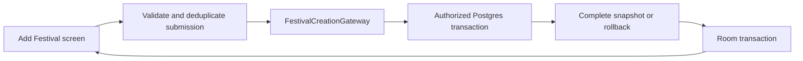

# ADR 0014: Atomic festival creation and safe retry

## Status

Accepted. The user explicitly approved the recommended transaction/API change
with “Please proceed” on 16 October 2026. Related task: TASK-197.

## Context

The previous Add Festival use case wrote the festival, each band, planning
prefill, and lineup through separate repositories. The Summer Breeze import
failed when two exact names generated the same display slug ID. Earlier writes
remained committed. Cached checks and generic festival updates also allowed an
archived festival identity to be reused.

The creation is one business operation. A complete remote result and a complete
local cache publication are the observable boundaries.

## Decision

- Add a narrow application `FestivalCreationGateway`. The use case validates
  the explicit name/session and deduplicates exact band names before delegating.
  It no longer coordinates unrelated partial repository saves.
- Persist creation through `create_festival_from_bands`, a SECURITY INVOKER
  Postgres function. This adapter contract implements the specified exact-name
  identity resolution and latest personal-rating prefill while enforcing the
  relational invariants in the same transaction. Domain objects and application
  signatures have no database or Android dependency.
- Keep member RLS in effect; authorize the canonical group and derive the actor
  from `auth.uid()`. Revoke PUBLIC/anon execution. Do not elevate to SECURITY DEFINER.
- Serialize creation for the one shared group using a transaction advisory lock,
  alongside the existing unique active-festival index. Reject existing festival
  identities instead of changing historical records.
- Assign new catalog rows UUID identities, independent of lossy slugs. Exact
  names reuse existing records without changing metadata or personal history.
- Persist a caller-owned request ledger in the same transaction. A deterministic
  UUID derived from the session and normalized submission identifies a retry.
  Verify the complete payload on replay. Replay reads the current complete
  result and preserves ratings edited after the original creation.
- Return the festivals, lineup bands with metadata, lineup, requester planning
  ratings, and counts in the response. Validate the response session, then
  publish it in one Room transaction. Preserve local pending edits on replay.
- A remote commit followed by a lost response or a local cache failure can be
  confirmed by retrying the same name and CSV. A complete remote creation may
  therefore exist before local confirmation; no partial remote creation exists.
- Require the disposable PostgreSQL/PostgREST integration gate and Android
  instrumentation suite in CI and the release process. Optional local integration
  skips in an ordinary unit run never satisfy that gate.

## Creation flow

## Consequences

The feature makes one remote creation request instead of per-band write
requests. Failures roll back the remote operation and local publication
independently; idempotency reconnects them after an ambiguous response.

The database adapter must uphold the gateway's matching/prefill contract, so
its real API/schema tests are mandatory. The request ledger adds a small table
and is removed with its festival. A new command for an already active or
archived identity is rejected. Recovery of pre-existing partial legacy imports
requires an audited support transaction; normal creation cannot silently adopt
an arbitrary partial record.

## Alternatives considered

- Client-only collision fix: retains partial writes and ambiguous retries.
- Compensating deletes: could remove records another device has already used.
- General import staging/jobs: unnecessary for the current one-group workflow.

## Links

- TASK-197 and the 16 October creation incident report.
- ADR 0011: festival lifecycle and exact-name reuse.
- ADR 0008: Flyway-managed Supabase schema.
